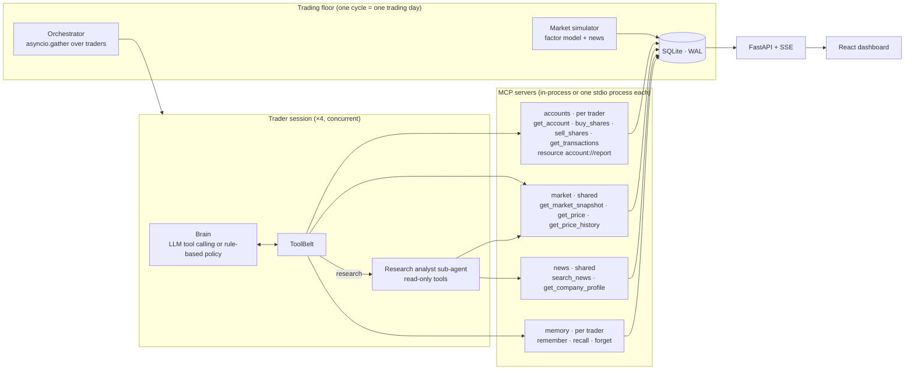
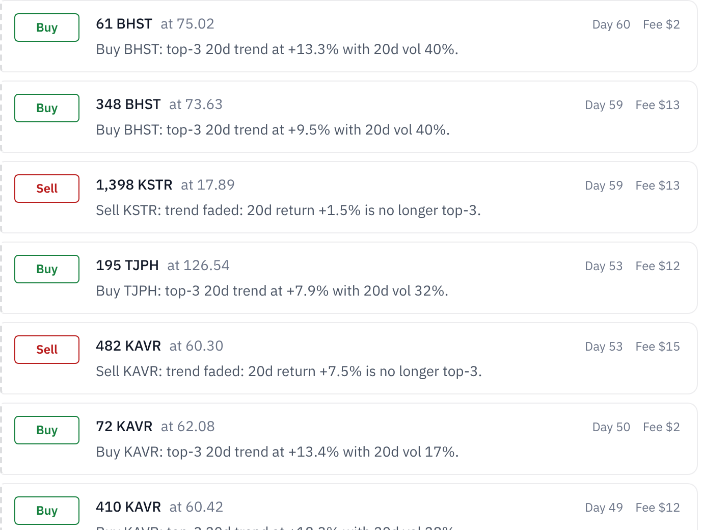
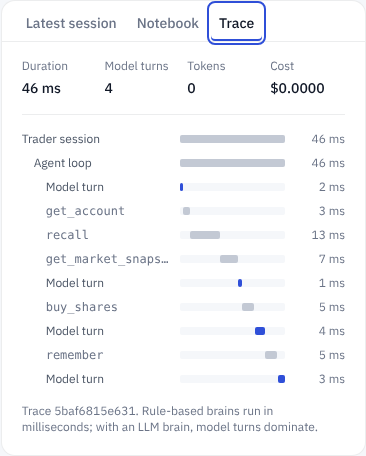

<div align="center">

# Agora

**An autonomous paper-trading floor where AI trader agents run real portfolios entirely through MCP tools, with a risk engine they cannot talk their way around.**

    


</div>

Four traders work the floor, each with its own strategy, account and private notebook:

| Trader | Strategy |
|---|---|
| **Vale** | value: cheap, dividend-paying businesses, held patiently |
| **Kite** | momentum: rides the strongest 20-day trends, cuts anything that stops working |
| **Hollis** | sector rotation: moves into the strongest sector, keeps a defensive staples sleeve |
| **Juno** | contrarian: buys sharp sell-offs that have no bad news behind them |

Every trading day, each agent opens MCP sessions to the floor's servers. It reads its account, its notes and the market, consults a **research analyst sub-agent**, places orders with written rationales, and writes a note for tomorrow. The dashboard shows it all live: the equity race against an equal-weight benchmark, every order ticket with its reasoning, orders the risk engine rejected, and each tool call the agent made.

## Why I built it this way

Letting an LLM place trades is the canonical "agents with real side effects" problem. Every design choice here answers one question: **what stops a confused or manipulated agent from doing damage?**

| Concern | Design answer |
|---|---|
| An agent touching another trader's book | **Identity is bound when the MCP server is built.** The accounts server for Kite has no `trader_id` parameter anywhere, so no prompt can redirect it. Least privilege by construction. |
| An agent ignoring its risk limits | **Limits live in the accounts server, not the prompt.** Position ≤ 30% of equity, order ≤ 25%, a trade budget per day, no shorting, a rationale required. |
| Rejections that just stop the agent | A rejected order returns a **structured, actionable error** ("order is 31% of equity, the limit is 25%. Max size now is 142 shares"). The agent resizes and retries; my tests check that it does. |
| Untraceable decisions | Every fill is stored with the agent's rationale, and every tool call is logged as an event. Sessions are traced with turns, tokens, cost and latency. |
| "Is the LLM any good?" with no baseline | **Rule-based policy brains** drive the *same* MCP tools. They make the floor runnable offline and give a baseline LLM traders must beat in the backtest. |

## Architecture



- **The servers are real MCP servers** (official Python SDK, FastMCP), so any MCP client can use them. `agora mcp-config --trader guest` prints a Claude Desktop / Cursor config, and you can **trade on the floor yourself against the agents**.
- **Two transports.** In-process memory streams (fast, the default), or `--stdio`, which launches every server as its own OS process, the way a production MCP deployment runs. SQLite in WAL mode lets separate processes share one state.
- **Agent-as-tool.** The researcher is a full agent loop with its own read-only tool belt, exposed to traders as a single `research(question)` tool. A negative research signal vetoes a new position.
- **The agent loop** ([`agents/runtime.py`](src/agora/agents/runtime.py)) turns MCP tool schemas into OpenAI-style function definitions, routes calls back to the right session, feeds errors to the model as tool messages, and stops at a turn budget with a forced summary.

## Backtest: how the strategies actually do

`agora backtest` runs the rule-based traders on the simulator and reports risk-adjusted performance against an equal-weight buy-and-hold benchmark.

**120 trading days, seed 7:**

| Trader | Strategy | Return | Ann. vol | Sharpe | Max drawdown | Trades | Turnover | Fees |
|---|---|---|---|---|---|---|---|---|
| Hollis | macro | +17.2% | 21.5% | 1.66 | −6.1% | 106 | 23.5x | 1,328 |
| Juno | contrarian | +12.0% | 16.7% | 1.51 | −10.5% | 65 | 12.5x | 723 |
| Kite | momentum | +2.1% | 23.8% | 0.30 | −12.6% | 142 | 30.0x | 1,595 |
| Vale | value | −5.6% | 16.6% | −0.65 | −9.5% | 8 | 1.1x | 53 |
| Equal-weight universe | buy and hold | +15.4% | 22.1% | 1.47 | −12.9% | 0 | 1.0x | 0 |

**Sharpe ratio across three seeds:**

| Strategy | seed 7 | seed 21 | seed 42 |
|---|---|---|---|
| Sector rotation (Hollis) | 1.66 | −1.95 | 1.52 |
| Contrarian (Juno) | 1.51 | 0.85 | 0.65 |
| Momentum (Kite) | 0.30 | −3.53 | −0.19 |
| Value (Vale) | −0.65 | −0.88 | 0.01 |
| Benchmark | 1.47 | −1.12 | 1.10 |

**Reading this honestly.** The simulator is a random walk with drift plus news shocks. There is **no persistent trend**, so momentum has no edge by construction, and it loses to its own turnover (up to 30x) and fees. The harness correctly refuses to invent profits that aren't there. Three seeds are too few to call any strategy a winner. What the backtest *does* show is that the plumbing is sound: costs, limits, rebalancing and metrics behave the way finance says they should.

## Quick start

```bash
pip install -e ".[dev]" && (cd web && npm ci)
make serve                 # builds the dashboard, then http://localhost:8000
                           # press "Run next day", or turn on Autopilot

agora cycle -n 5 -v        # run five trading days from the terminal
agora backtest --days 120  # risk-adjusted performance report → results/
agora cycle --stdio        # same floor, every MCP server in its own process

cp .env.example .env       # AGORA_BRAIN=llm + any OpenAI-compatible key for real LLM traders
agora cycle --llm -v
```

**Trade against the agents from Claude Desktop:** run `agora mcp-config --trader guest` and paste the output into your MCP client config. You get your own account with the same risk limits.

**Static demo:** `make demo` records a 60-day run into JSON and builds a backend-free dashboard in `web/dist-demo`, which you can host anywhere.

## The dashboard

The design treats the floor like an exchange's paper trail rather than a crypto app.
- **Palette:** cool ink neutrals with one cobalt accent for the selected trader and the primary action. Green and red appear only on gains and losses.
- **Order tickets** are the signature detail: a perforated edge, a Buy, Sell or Rejected stamp, and the agent's own rationale.
- **The equity chart** is drawn by hand in SVG. It labels each line directly instead of using a legend, has a crosshair tooltip, and drawing order keeps the selected trader on top.
- **Trace tab:** a waterfall of every span in the agent's last session (model turns, MCP tool calls, the research sub-agent), with duration, turns, tokens and cost.
- **Built on Radix primitives** (Tabs, Switch, Tooltip), the accessible base layer that shadcn/ui and 21st.dev components use, styled with the dashboard's own tokens. **Motion** animates leaderboard rank changes and tweens figures when a day completes.
- **Live updates** arrive over SSE, which tails the event log, so progress shows as it happens ("Kite is placing orders").
- **Quality floor:** responsive down to phone width, visible keyboard focus, `prefers-reduced-motion` respected, tabular figures everywhere.

<p>


</p>

## Project layout

```
src/agora/
  mcp_servers/   accounts · market · news · memory (FastMCP) and the stdio entry point
  agents/        runtime (ToolBelt + loop) · brains (LLM tool calling) · policies (rule-based) · personas
  floor.py       cycle orchestration, MCP sessions over memory or stdio, researcher-as-tool
  ledger.py      order execution, spread and fees, the risk engine
  market/sim.py  seeded factor-model simulator with generated news
  metrics.py     return, volatility, Sharpe, drawdown, turnover, benchmark
  api/server.py  FastAPI, SSE event stream, autopilot, static hosting
web/             React + TypeScript + Vite dashboard: Radix primitives, Motion, hand-drawn SVG chart
tests/           26 tests: ledger and risk, MCP servers (incl. a real stdio subprocess), agent branches, API
```

## Roadmap
- Live market data adapter (Polygon / Alpha Vantage) behind the same market server interface
- An LLM-vs-policy tournament across seeds, with cost per basis point of excess return
- Human approval for orders above a size threshold (MCP elicitation)
